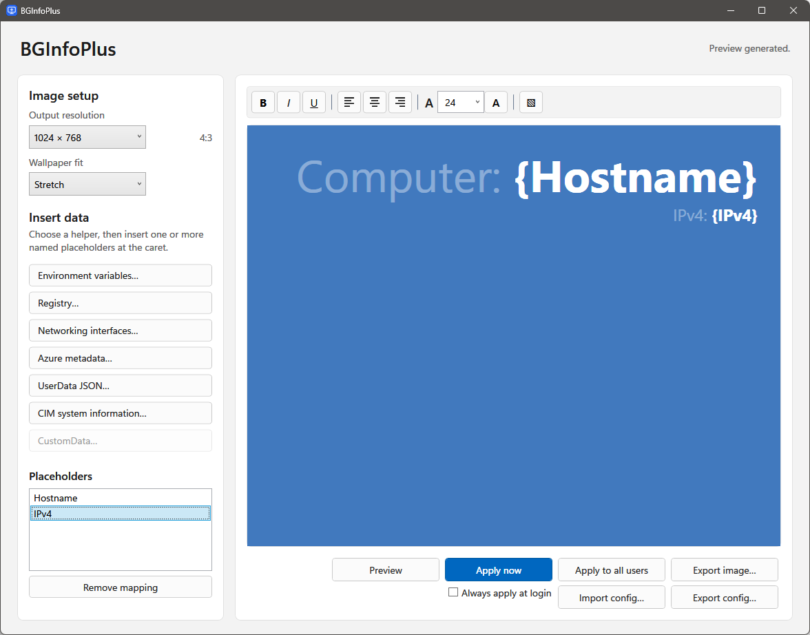

# BGInfoPlus

A Windows wallpaper information utility for Azure VMs, built with C# and WPF. Create a formatted layout, insert live system values, and preview, export, or apply the result.



## Data Sources

The editor provides helpers for environment variables, registry values, per-interface networking, Azure Instance Metadata Service values, scalar UserData JSON values, and common CIM system information. Missing or unavailable values resolve to empty text.

Azure CustomData is reserved and currently disabled.

## Quick Start

Install the machine-wide MSI or use the portable ZIP. The portable ZIP needs no installation or separate .NET runtime; the standalone EXE is also available for direct use.

1. Start by inserting data from the available data helpers. A helper inserts a named placeholder such as `{Hostname}` at the cursor.
2. Lay out the placeholders, change colors and formatting.
3. Choose an output resolution, then select **Preview**, **Export image**, or **Apply wallpaper**.

**Always apply at login** regenerates the current user's wallpaper at sign-in.

For shared systems, **Deploy for all users…** saves a protected machine-wide template and registers a delayed interactive logon task. Azure VM Application installation provisions its default template and task automatically.

## Build and Test

Use the .NET 10 SDK on Windows:

```powershell
dotnet build src/BGInfoPlus -c Release
dotnet run --project tests/BGInfoPlus.Tests -c Release
```

The test executable covers bounded UserData parsing, formatted placeholder behavior, configuration validation, Tab round-tripping, font-size bounds, recent colors, rendering, and atomic writes. Machine-specific Azure, registry, networking, and desktop behavior remains integration-tested.

## More documentation

- [Installation, releases, and Azure VM Applications](docs/deployment.md)
- [Preparing a reference image](docs/reference-image.md)

## Limitations

Rendering is limited to 3840 × 2160. Azure UserData accepts UTF-8 JSON or Base64-encoded UTF-8 JSON, is read but never executed, and is limited to 256 KiB, 256 scalar values, and 4,096 characters per value.

Windows wallpaper-fit settings and administrator policy still control how the generated image is displayed or whether it can be applied.

## Copyright

No infringement intended on BGInfo (available from Microsoft Sysinternals). Hi, Mark!
